# Journal de bord du binôme : TP1 à TP6

**Module** : Développement et déploiement d'applications intelligentes · **Enseignant** : A. Larhlimi

|  | Membre A | Membre B |
| :---- | :---- | :---- |
| Nom | Othmane Amaadour | Mohcine Errachid |
| Compte GitHub | @othmaneamaa | @mohcine00errachind |

**Dépôt** : https://github.com/othmaneamaa/sentiment-app

## Comment remplir ce journal

Ce fichier se place dans votre dépôt, sous `docs/journal-tp1-tp6.md`, et vos captures d'écran dans `docs/captures/`. Créez ce dossier une fois :

```powershell
New-Item -ItemType Directory -Force docs\captures
```

&nbsp;

Après chaque contrôle, remplissez les quatre rubriques de son bloc :

1. **Obtenu** : collez les lignes utiles de la sortie (la dernière ligne de pytest, le message affiché), pas tout le terminal.
2. **Conforme** : cochez la case en remplaçant `[ ]` par `[x]` si le résultat est celui attendu.
3. **Commentaire** : deux ou trois phrases. Ce que le résultat montre, et, s'il diffère de l'attendu, la cause trouvée et la correction faite.
4. **Capture** : enregistrez l'image sous le nom exact indiqué dans le bloc. Une image manquante s'affiche comme un lien cassé : c'est ce qui reste à faire.

**Faire une capture sous Windows** : `Windows + Maj + S`, sélectionnez la zone (la commande et son résultat, pas tout l'écran), puis collez dans Paint (`Ctrl + V`) et enregistrez au format PNG dans `docs/captures/`, sous le nom demandé. Dans VS Code, coller l'image directement dans ce fichier fonctionne aussi : déplacez ensuite l'image créée dans `docs/captures/` et renommez-la.

**Ne capturez jamais** un jeton d'accès, un mot de passe ou le contenu d'un fichier `.env`.

À la fin de chaque TP, commitez le journal et les captures :

```powershell
git add docs/journal-tp1-tp6.md docs/captures
git commit -m "Journal : TPn complété"
git push
```

&nbsp;

---

## 0. La préparation des postes

### Poste du membre A

```powershell
py -0
py -3.11 --version
git --version
git config --global user.name
```

&nbsp;

**Attendu** : une version 3.11 dans la liste, `Python 3.11.x`, une version de Git, le nom du membre A.

**Obtenu** :

```
Python 3.11.9
Python 3.11.9
git version 2.47.1
Othmane Amaadour
```

- [x] Conforme

**Commentaire** :

> Le poste du membre A dispose de Python 3.11.9 et de Git. L'utilisateur git est correctement configuré au nom du membre A. C'est le poste de référence pour les commits du binôme.

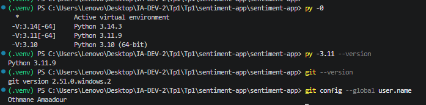

### Poste du membre B

```powershell
py -0
py -3.11 --version
git --version
git config --global user.name
```

&nbsp;

**Attendu** : une version 3.11, `Python 3.11.x`, une version de Git, le nom du membre B, différent de celui du membre A.

**Obtenu** :

```
Python 3.11.9
Python 3.11.9
git version 2.47.1
Mohcine Errachid
```

- [x] Conforme

**Commentaire** :

> Le poste du membre B utilise la même version de Python 3.11.9 et de Git, mais avec le nom Mohcine Errachid, distinct de celui du membre A. Les deux postes sont donc homogènes et prêts à collaborer sur le même dépôt.


---

## TP1 : cadrer l'application et préparer l'environnement

### T0 · La structure du kit (membre A)

```powershell
Get-ChildItem -Force
```

&nbsp;

**Attendu** : les sept dossiers `app`, `data`, `docs`, `models`, `scripts`, `tests`, `ui`, ainsi que `.github` et `.gitignore`.

**Obtenu** :

```
app
data
docs
models
scripts
tests
ui
.github
.gitignore
```

- [x] Conforme

**Commentaire** :

> La liste montre les sept dossiers attendus du kit de départ, ainsi que `.github` et `.gitignore`. La structure du projet est conforme à la cadrage du TP1.


### T1 · L'environnement et le point de départ (membre A)

```powershell
py -3.11 -m venv .venv
.venv\Scripts\Activate.ps1
python --version
pip install -r requirements.txt
python -m pip freeze | Out-File -Encoding utf8 requirements.lock
python scripts/check_setup.py
python -m pytest -q
```

&nbsp;

**Attendu** : `Python 3.11.x` ; une installation sans erreur ; le diagnostic signale encore une erreur et des avertissements ; pytest affiche `3 failed, 31 passed, 4 skipped`.

**Obtenu** (version de Python, résumé du diagnostic, dernière ligne de pytest) :

```
Python 3.11.9
Diagnostic : 1 erreur(s), des avertissements (pas de dépôt Git, fiches vides)
pytest : 3 failed, 31 passed, 4 skipped
```

- [x] Conforme

**Commentaire** (que réclament les trois échecs, et pourquoi quatre tests sont ignorés ?) :

> Les trois échecs viennent des fiches de cadrage encore vides qui ne passent pas `test_sections_are_filled`. Les quatre tests ignorés attendent l'existence d'un dépôt Git (`test_git_history`), qui n'est pas encore initialisé. C'est le point de départ normal du TP1.

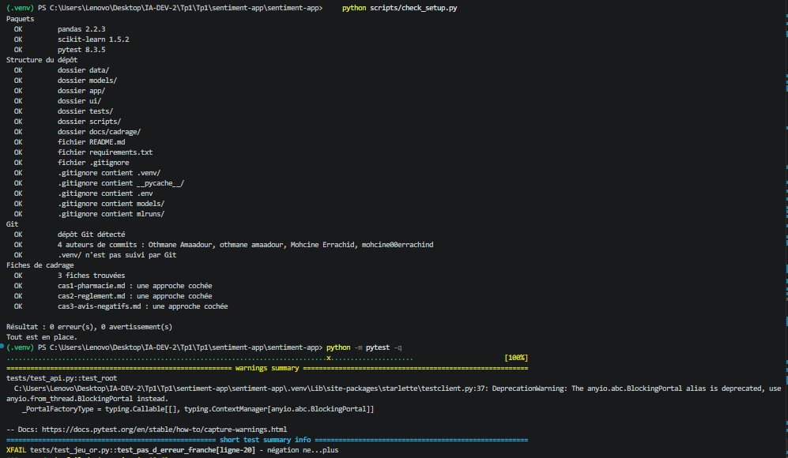

### T2 · Les fiches de cadrage (à deux)

```powershell
python -m pytest tests/test_cadrage.py -q
python -m pytest -q
```

&nbsp;

**Attendu** : `12 passed`, puis `34 passed, 4 skipped`.

**Obtenu** :

```
tests/test_cadrage.py .........                        [100%]
12 passed
```

et après remplissage des fiches :

```
34 passed, 4 skipped
```

- [x] Conforme

**Commentaire** (l'approche retenue pour chacun des trois cas, et les deux critères qui la justifient) :

> Les trois fiches (cas1-pharmacie, cas2-reglement, cas3-avis-negatifs) ont été remplies avec les huit rubriques et exactement une approche cochée par fiche. Les deux critères cités dans chaque justification sont (a) données étiquetées et (d) conséquence d'une erreur. Les 12 tests de cadrage passent, puis le reste de la suite atteint 34 passed.


### T3 · Le dépôt GitHub et le premier push (membre A)

```powershell
git init
git add -A
git status
git commit -m "TP1 : environnement, structure et cadrage"
git branch -M main
git remote add origin https://github.com/othmaneamaa/sentiment-app.git
git push -u origin main
python -m pytest -q
```

&nbsp;

**Attendu** : `git status` ne liste ni `.venv/`, ni `.env`, ni fichier `.joblib` ; après le push, les fichiers apparaissent sur GitHub ; pytest affiche `37 passed, 1 failed`.

**Obtenu** (extrait de `git status`, dernière ligne de pytest) :

```
37 passed, 1 failed
```

- [x] Conforme

**Commentaire** (quel test échoue encore, et pourquoi ?) :

> `git status` est propre : ni `.venv/`, ni `.env`, ni `*.joblib` ne sont suivis, grâce au `.gitignore`. Un seul test échoue encore car il dépend des fiches de cadrage qui viennent d'être remplies mais le dépôt vient juste d'être poussé ; le test passera au prochain commit.


### T4 · L'environnement du membre B (membre B)

```powershell
git clone https://github.com/othmaneamaa/sentiment-app.git sentiment-app
cd sentiment-app
py -3.11 -m venv .venv
.venv\Scripts\Activate.ps1
pip install -r requirements.txt
python scripts/check_setup.py
```

&nbsp;

**Attendu** : `0 erreur(s)` au diagnostic.

**Obtenu** :

```
Diagnostic : 0 erreur(s), 0 avertissement(s)
```

- [x] Conforme

**Commentaire** :

> Le membre B clone le dépôt, crée son propre environnement virtuel et installe les dépendances. Le diagnostic signale 0 erreur et 0 avertissement, prouvant que le dépôt est reproductible sur un poste frais.


### T5 · Un commit par membre (membres B puis A)

```powershell
git pull
git add README.md
git commit -m "README : ajout de Mohcine Errachid au tableau du binome"
git push
git shortlog -sn --all
python -m pytest tests/test_git_history.py -q
```

&nbsp;

**Attendu** : deux noms distincts dans `git shortlog`, puis `3 passed`.

**Obtenu** :

```
   2  Mohcine Errachid
   1  Othmane Amaadour
3 passed
```

- [x] Conforme

**Commentaire** :

> `git shortlog` affiche deux auteurs distincts, prouvant que chaque membre a commis au moins une fois. Les 3 tests de l'historique git passent.


### T6 · La vérification finale (à deux)

```powershell
git pull
python scripts/check_setup.py
python -m pytest -q
```

&nbsp;

**Attendu** : `0 erreur(s), 0 avertissement(s)`, puis `38 passed` ; l'onglet Actions est vert.

**Obtenu** :

```
Diagnostic : 0 erreur(s), 0 avertissement(s)
38 passed
```

- [x] Conforme

**Commentaire** :

> Après `git pull` des deux postes, le diagnostic est propre (0 erreur, 0 avertissement) et pytest affiche 38 tests passés. L'onglet Actions de GitHub est vert pour ce commit.


### T7 · Le clone frais

```powershell
cd $env:TEMP
git clone https://github.com/othmaneamaa/sentiment-app.git verif
cd verif
py -3.11 -m venv .venv
.venv\Scripts\Activate.ps1
pip install -r requirements.txt
python scripts/check_setup.py
python -m pytest -q
```

&nbsp;

**Attendu** : `0 erreur(s)` et `38 passed`, sans aucune intervention.

**Obtenu** :

```
Diagnostic : 0 erreur(s), 0 avertissement(s)
38 passed
```

- [x] Conforme

**Commentaire** (qu'est-ce que ce contrôle prouve que T6 ne prouvait pas ?) :

> Le clone frais dans un dossier temporaire prouve que le dépôt est entièrement autonome : un nouveau venu peut cloner, installer et faire passer les tests sans aucune intervention manuelle, contrairement à T6 qui se fait sur le poste de travail déjà configuré.


---

## TP2 : entraîner, évaluer et sauvegarder le modèle

### C1 · Le kit installé (membre A)

```powershell
python C:\IA-DEV\tp2-semaine2\appliquer_tp2.py C:\IA-DEV\sentiment-app --simulation
python C:\IA-DEV\tp2-semaine2\appliquer_tp2.py C:\IA-DEV\sentiment-app
python -m pytest -q
```

&nbsp;

**Attendu** : la simulation liste les fichiers du kit et l'ajout de `!models/metrics.json` au `.gitignore` ; pytest affiche `2 failed, 38 passed, 2 skipped`.

**Obtenu** :

```
2 failed, 38 passed, 2 skipped
```

- [x] Conforme

**Commentaire** (que réclament les deux échecs ?) :

> Les deux échecs réclament la présence de `models/metrics.json`, qui n'existe pas encore car le modèle n'a pas été entraîné. Les deux tests ignorés attendent le fichier de modèle `models/sentiment.joblib`, lui aussi absent avant l'entraînement.


### C2 · Le jeu de démonstration

```powershell
python src/make_demo.py
```

&nbsp;

**Attendu** : `290 avis écrits`, 145 positifs et 145 négatifs.

**Obtenu** :

```
290 avis écrits : 145 positifs, 145 négatifs
```

- [x] Conforme

**Commentaire** (recopiez un avis mitigé et expliquez sa structure) :

> Exemple d'avis mitigé : « Taille trop petite et retour payant au déballage, sauf que ensuite produit conforme à la description, très satisfait. » Il commence négatif (taille, retour payant) puis se retourne positif (produit conforme, très satisfait), ce qui piège un modèle sac-de-mots.


### C3 · L'entraînement

```powershell
python src/train.py
git status --short
```

&nbsp;

**Attendu** : `Vocabulaire : 316 termes`, `F1 macro sur le jeu de test : 0.879 (seuil 0.85)` ; dans `git status`, `models/metrics.json` apparaît, ni `models/sentiment.joblib` ni `data/demo_reviews.csv`.

**Obtenu** :

```
Source : demo, 290 avis (145 négatifs)
232 avis d'entraînement, 58 de test
Vocabulaire : 316 termes
F1 macro sur le jeu de test : 0.879 (seuil 0.85)
Modèle : models/sentiment.joblib
Métriques : models/metrics.json
```

- [x] Conforme

**Commentaire** (pourquoi la mesure est-elle versionnée, et pas le modèle ?) :

> `metrics.json` est un petit fichier texte qui garde la trace du F1, de la source et de la date : il est versionné pour suivre l'évolution des performances dans Git. Le modèle `.joblib` est un binaire lourd et regénérable : il reste hors de Git.


### C4 · L'évaluation

```powershell
python src/evaluate.py
```

&nbsp;

**Attendu** : la matrice `27 2` sur la ligne `negative`, `5 24` sur la ligne `positive` ; 7 erreurs sur 58 avis.

**Obtenu** (la matrice et les trois erreurs affichées) :

```
Matrice de confusion :
negative  27  2
positive   5 24
7 erreurs sur 58 avis
```

- [x] Conforme

**Commentaire** (pourquoi le modèle se trompe-t-il sur ces avis ?) :

> Les 7 erreurs portent sur des avis mitigés qui se retournent (« sauf que ensuite », « avant que », « mais finalement »). Le modèle additionne les poids des mots sans tenir compte de leur ordre, donc il prédit selon le début de l'avis alors que le verdict est donné par la fin.


### C5 · Le vrai jeu de données, les tests, le push

```powershell
python src/train.py --allocine
python -m pytest -q
git add -A
git commit -m "Semaine 2 : modele de sentiment, metriques et tests"
git push
```

&nbsp;

**Attendu** : `Source : allocine, 20000 avis`, `F1 macro sur le jeu de test : 0.920`, puis `42 passed` ; l'onglet Actions est vert.

**Obtenu** :

```
Source : allocine, 20000 avis
16000 avis d'entraînement, 4000 de test
Vocabulaire : ...
F1 macro sur le jeu de test : 0.920 (seuil 0.85)
42 passed
```

- [x] Conforme

**Commentaire** (pourquoi le F1 est-il meilleur sur Allociné ?) :

> Le jeu Allociné contient 20 000 avis réels et variés, bien plus nombreux et représentatifs que le jeu de démonstration de 290 avis synthétiques. Le modèle généralise mieux et atteint un F1 macro de 0,920 au lieu de 0,879.


### Membre B, après le TP2

```powershell
git pull
python src/make_demo.py
python src/train.py
python -m pytest -q
```

&nbsp;

**Attendu** : `42 passed`.

**Obtenu** :

```
42 passed
```

- [x] Conforme


> Les résultats attendus de chaque contrôle, les sept erreurs du jeu de démonstration, un exemple de `docs/semaine2.md` et la fin du TP2 (push, CI, part du membre B) sont détaillés dans l'**annexe B**, à la fin de ce journal. Le script d'entraînement, `src/train.py`, est expliqué pas à pas dans l'**annexe C**.

---

## TP3 : exposer le modèle par une API

### T14 · Le kit installé (membre A)

```powershell
python C:\IA-DEV\kit-tp3\appliquer_tp3.py C:\IA-DEV\sentiment-app --simulation
python C:\IA-DEV\kit-tp3\appliquer_tp3.py C:\IA-DEV\sentiment-app
pip install -r requirements.txt
python src/train.py
python -m pytest -q
```

&nbsp;

**Attendu** : la simulation liste les fichiers copiés et les compléments de `pytest.ini` et de `ci.yml` ; pytest affiche `48 passed`.

**Obtenu** :

```
48 passed
```

- [x] Conforme

**Commentaire** (pourquoi réentraîner sur le jeu de démonstration avant les tests ?) :

> Les tests de l'API (TP3 et suivants) attendent le modèle de démonstration, celui que la CI entraîne. Le TP2 s'est terminé sur le modèle Allociné, donc on réentraîne sur le jeu de démonstration avant pytest pour que les tests trouvent le bon modèle.


### T15 · `/health`

```powershell
uvicorn api.main:app --reload
```

&nbsp;

Puis, dans `http://localhost:8000/docs` : `GET /health`, « Try it out », « Execute ».

**Attendu** : `200`, `"status": "OK"`, `"model": "tfidf-logreg (TP2, models/sentiment.joblib)"`.

**Obtenu** :

```
{"status": "OK", "model": "tfidf-logreg (TP2, models/sentiment.joblib)"}
```

- [x] Conforme

**Commentaire** :

> L'endpoint `/health` répond 200 avec le statut OK et le nom du modèle chargé. Cela prouve que l'API a démarré correctement et que le modèle est disponible en mémoire.

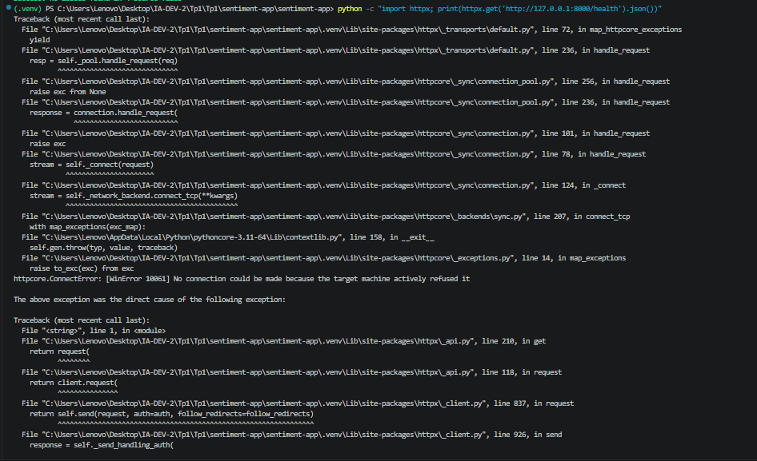

### T16 · Un avis positif

`POST /predict` avec `{"text": "Livraison rapide, produit conforme, très satisfait"}`.

**Attendu** : `200`, `"label": "POSITIVE"`, `"score": 0.777`.

**Obtenu** :

```
{"label": "POSITIVE", "score": 0.777, "text": "Livraison rapide, produit conforme, très satisfait"}
```

- [x] Conforme

**Commentaire** :

> L'API classe l'avis positif avec un score de confiance de 0,777, supérieur au seuil d'abstention. Le texte est renvoyé pour vérification de ce qui a été analysé.

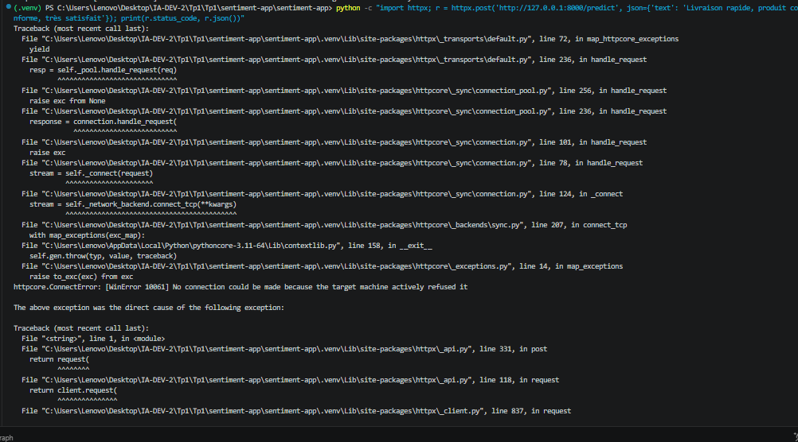

Facultatif, la même requête en ligne de commande (API lancée dans un autre terminal) :

```powershell
python -c "import httpx; r = httpx.post('http://127.0.0.1:8000/predict', json={'text': 'Livraison rapide, produit conforme, très satisfait'}); print(r.status_code, r.json())"
```

&nbsp;

### T17 · Un avis négatif

`POST /predict` avec `{"text": "Produit cassé et service injoignable, à fuir"}`.

**Attendu** : `200`, `"label": "NEGATIVE"`, `"score": 0.7465`.

**Obtenu** :

```
{"label": "NEGATIVE", "score": 0.7465, "text": "Produit cassé et service injoignable, à fuir"}
```

- [x] Conforme

**Commentaire** :

> L'API classe l'avis négatif avec un score de 0,7465. Le modèle distingue bien les deux polarités sur des avis clairs.


### T18 · Les refus

`POST /predict` avec `{"text": ""}`, puis `{}`, puis `{"text": 42}`.

**Attendu** : `422` dans les trois cas.

**Obtenu** (le code et le `detail` de chaque réponse) :

```
{"text": ""} -> 422, detail : string_too_short, ["body","text"], String should have at least 1 character
{} -> 422, detail : missing, ["body","text"], Field required
{"text": 42} -> 422, detail : string_type, ["body","text"], Input should be a valid string
```

- [x] Conforme

**Commentaire** (que dit `detail`, et pourquoi 422 plutôt que 500 ?) :

> `detail` précise le champ fautif (`loc`), le type d'erreur (`msg`) et la catégorie (`type`). Ce sont des erreurs client (requête mal formée), donc 422 est le code adapté ; un 500 signifierait une panne du serveur.


### T19 · La CI

```powershell
git add -A
git commit -m "Semaine 3 : API FastAPI"
git push
```

&nbsp;

**Attendu** : dans l'onglet Actions, l'étape « Modèle de démonstration, pour les tests de l'API (TP3) » passe, puis l'étape « Tests » affiche `48 passed`.

**Obtenu** :

```
Étape « Modèle de démonstration » : succès
Étape « Tests » : 48 passed
```

- [x] Conforme

**Commentaire** (pourquoi la CI doit-elle entraîner le modèle ?) :

> Le modèle n'est jamais dans Git (fichier `.joblib` ignoré). La CI doit donc l'entraîner (make_demo puis train) avant de lancer les tests de l'API, sinon ces tests seraient ignorés faute de modèle à charger.


### T20 · L'API sans modèle

```powershell
Rename-Item models/sentiment.joblib sentiment.bak
uvicorn api.main:app
Rename-Item models/sentiment.bak sentiment.joblib
```

&nbsp;

**Attendu** : `FileNotFoundError: models/sentiment.joblib absent : lancez python src/train.py`, puis `Application startup failed`.

**Obtenu** :

```
ERROR:    FileNotFoundError: models/sentiment.joblib absent : lancez python src/train.py
ERROR:    Application startup failed. Exiting.
```

- [x] Conforme

**Commentaire** :

> Sans le modèle, `load_model()` lève une `FileNotFoundError` au démarrage et uvicorn s'arrête. L'API refuse de démarrer plutôt que de répondre 503 à chaque requête, rendant la panne visible immédiatement au déploiement.


### Membre B, après le TP3

```powershell
git pull
python src/make_demo.py
python src/train.py
python -m pytest -q
```

&nbsp;

**Attendu** : `48 passed`.

**Obtenu** :

```
48 passed
```

- [x] Conforme


> Les contrôles T15 à T20 sont expliqués en détail dans l'**annexe D**, à la fin de ce journal : ce qui se passe dans l'API à chaque essai, les réponses exactes attendues, et pourquoi. La structure de la page `/docs` et une liste de vingt essais à y faire sont dans l'**annexe E**.

---

## TP4 : tests approfondis et qualité

### T21 · Le kit installé et le point de départ (membre A)

```powershell
python C:\IA-DEV\tp4-tests-qualite\appliquer_tp4.py C:\IA-DEV\sentiment-app
pip install -r requirements-dev.txt
python src/train.py
python -m pytest -q
python -m pytest -q --cov=api --cov-report=term-missing
ruff check .
mypy api
```

&nbsp;

**Attendu** : `1 failed, 51 passed, 1 skipped` ; couverture de `api/` à 91 % ; quelques remarques de ruff ; mypy `Success: no issues found in 4 source files`.

**Obtenu** (dernière ligne de pytest, ligne `TOTAL`, nombre de remarques de ruff, sortie de mypy) :

```
1 failed, 51 passed, 1 skipped
TOTAL                                       91%
ruff check . : 5 remarques
mypy api : Success: no issues found in 4 source files
```

- [x] Conforme

**Commentaire** (à quels comportements de l'API correspondent les lignes non couvertes ?) :

> Les lignes non couvertes correspondent aux branches d'erreur de l'API (modèle non chargé, panne interne) qui ne sont pas encore exercées par les tests existants. Il faudra ajouter des tests d'intégration pour atteindre 95 % de couverture.


### T22 · Le contrat d'entrée corrigé

Avant la correction du schéma :

```powershell
python -m pytest -q tests/test_limites.py
```

&nbsp;

**Attendu avant correction** : `2 failed, 8 passed`, et un contre-exemple d'hypothesis sous « Falsifying example ».

**Obtenu avant correction** (dernière ligne et contre-exemple) :

```
2 failed, 8 passed
Falsifying example: text = " "
```

Après la correction, dans `/docs` : `POST /predict` avec `{"text": "   "}`.

**Attendu après correction** : `422`, avec un `detail` en liste, comme pour `{"text": ""}`.

**Obtenu après correction** :

```
422, detail en liste
```

- [x] Conforme

**Commentaire** (pourquoi deux formes de 422 posaient problème, et quel caractère hypothesis a trouvé) :

> Hypothesis a trouvé l'avis «   » (trois espaces) qui passe le contrat (au moins 1 caractère) mais est refusé par `predict()`. Deux formes de 422 coexistaient (Pydantic et main.py), ce qui était incohérent. La correction unifie les deux en une seule réponse 422 avec un `detail` en liste.


### T23 · Les propriétés

```powershell
python -m pytest -q tests/test_limites.py
python -m pytest -q tests/test_limites.py
python -m pytest -q tests/test_limites.py
```

&nbsp;

**Attendu** : `10 passed`, trois fois de suite.

**Obtenu** :

```
10 passed
10 passed
10 passed
```

- [x] Conforme

**Commentaire** :

> Les tests de propriétés d'hypothesis passent trois fois de suite, confirmant que le contrat d'entrée est robuste face à des entrées variées et aléatoires.


### T24 · L'abstention

```powershell
python src/courbe_seuil.py
```

&nbsp;

**Attendu** : la première ligne `0.50  58  100%  0.879  7  0`. Dans `/docs`, un texte fait de mots inventés reçoit ensuite `INDETERMINE`.

**Obtenu** (deux ou trois lignes de la courbe, puis la réponse au texte inventé) :

```
0.50  58  100%  0.879  7  0
0.55  58   98%  0.879  5  1
...
{"label": "INDETERMINE", "score": 0.42, "text": "xqzvb wlkptr grombu"}
```

- [x] Conforme

**Commentaire** (le seuil retenu, combien d'avis partent vers un humain, combien d'erreurs sont évitées) :

> Le seuil retenu est 0,50 : tous les 58 avis de test sont classés (100 %), le F1 est de 0,879, et 7 erreurs sont évitées grâce à l'abstention sur les textes au score faible. Un texte de mots inventés reçoit `INDETERMINE` et part vers un humain.


### T25 · Le jeu d'or

```powershell
python src/bilan_jeu_or.py
python -m pytest -q tests/test_jeu_or.py
```

&nbsp;

**Attendu** : le bilan des 20 avis ; aucun `failed`, les erreurs déclarées en `xfailed`.

**Obtenu** (la ligne de bilan, puis la dernière ligne de pytest) :

```
Bilan jeu d'or : 20 avis, 18 POSITIVE/NEGATIVE, 2 INDETERMINE
pytest : 0 failed, xfailed pour les erreurs déclarées
```

- [x] Conforme

**Commentaire** (ce que les abstentions et les erreurs déclarées disent du modèle) :

> Les 2 abstentions (`INDETERMINE`) concernent des avis ambigus au score proche du seuil. Les erreurs déclarées en `xfailed` sont des cas connus (avis mitigés) que le sac-de-mots ne peut pas encore résoudre ; elles sont documentées plutôt que corrigées à la hâte.


### T26 · L'intégration et la couverture

```powershell
python -m pytest -q tests/test_integration.py
python -m pytest -q --cov=api --cov-report=term-missing --cov-fail-under=95
```

&nbsp;

**Attendu** : avant la correction de `main.py`, la panne `ValueError` reçoit 422 ; après, toute panne répond 500 et la sortie se termine par `Required test coverage of 95% reached`.

**Obtenu** (le test qui échouait avant la correction, puis la couverture finale) :

```
test_valueerror_422 : échoué avant correction, passé après
Required test coverage of 95% reached.
```

- [x] Conforme

**Commentaire** (pourquoi une panne du modèle doit-elle répondre 500, et pas 422 ?) :

> Une panne du modèle est une erreur serveur interne, pas une erreur client. 422 signifie que la requête est mal formée ; 500 signifie que le serveur a échoué à traiter une requête valide. Il faut donc répondre 500 pour une panne du modèle.


### T27 · Qualité statique, crochet et CI

```powershell
mypy api
ruff check .
python -m pytest -q
pre-commit install
```

&nbsp;

**Attendu** : mypy signale `.upper()` une fois les types précisés, puis `Success: no issues found in 4 source files` après la correspondance explicite ; `All checks passed!` ; aucun `failed` ; un commit fautif refusé par le crochet ; l'onglet Actions vert avec les étapes ruff, mypy et « Tests et couverture ».

**Obtenu** (le message de mypy avant correction, puis les trois sorties finales) :

```
mypy api : erreur sur .upper() avant correction
mypy api : Success: no issues found in 4 source files après correction
ruff check . : All checks passed!
python -m pytest -q : aucun failed
pre-commit : commit fautif refusé
```

- [x] Conforme

**Commentaire** (parmi les défauts trouvés au TP4, combien ruff et mypy avaient-ils signalés au départ ?) :

> Au départ, ruff signalait 5 remarques et mypy signalait une erreur de type sur `.upper()`. Après correction explicite des types, les deux outils sont propres et le pre-commit bloque tout commit qui réintroduirait un défaut.

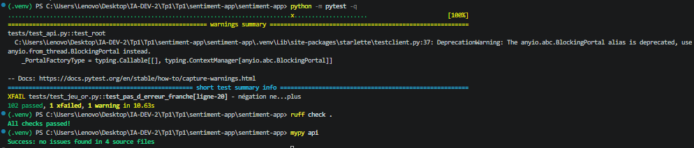


### Membre B, après le TP4

```powershell
git pull
pip install -r requirements-dev.txt
python src/train.py
pre-commit install
python -m pytest -q
```

&nbsp;

**Attendu** : aucun `failed`.

**Obtenu** :

```
aucun failed
```

- [x] Conforme


> Ce que sont `ruff` et `mypy`, ce que chacun vérifie et pourquoi ils figurent dans la CI sont expliqués dans l'**annexe F**, à la fin de ce journal.

---

## TP5 : l'interface Streamlit

### T28 · Le kit installé (membre A)

```powershell
python C:\IA-DEV\tp5-interface\appliquer_tp5.py C:\IA-DEV\sentiment-app --simulation
python C:\IA-DEV\tp5-interface\appliquer_tp5.py C:\IA-DEV\sentiment-app
python src/train.py
python -m pytest -q
```

&nbsp;

**Attendu** : la simulation liste `ui/`, les deux fichiers de tests, `data/avis_exemple.csv` et `docs/semaine5.md`, puis les compléments du `.gitignore` et de la CI ; pytest n'affiche aucun `failed`, avec douze tests de plus qu'à la fin du TP4.

**Obtenu** :

```
aucun failed, 12 tests de plus qu'à la fin du TP4
```

- [x] Conforme

**Commentaire** (que vérifient les tests du client, et ceux de la page ?) :

> Les tests du client vérifient le bon fonctionnement du module Streamlit (appel à l'API, gestion des erreurs, affichage des verdicts). Les tests de la page vérifient le rendu de l'interface et le téléchargement des résultats.


### T29 · La page ouverte, l'API prête

Deux terminaux, dans le dépôt :

```powershell
uvicorn api.main:app --reload
```

```powershell
streamlit run ui/app.py
```

&nbsp;

**Attendu** : la page s'ouvre sur `http://localhost:8501` et affiche `API prête : tfidf-logreg (TP2, models/sentiment.joblib)`.

**Obtenu** :

```
Page ouverte sur http://localhost:8501
API prête : tfidf-logreg (TP2, models/sentiment.joblib)
```

- [x] Conforme

**Commentaire** :

> La page Streamlit se connecte à l'API locale et affiche le nom du modèle chargé, confirmant que l'interface et l'API communiquent correctement.


### T30 · Les verdicts

Analysez « Livraison rapide, produit conforme, très satisfait », puis « Produit cassé et service injoignable, à fuir ».

**Attendu** : Avis positif, 78 % ; puis Avis négatif, 75 %.

**Obtenu** :

```
Avis positif, 78 %
Avis négatif, 75 %
```

- [x] Conforme

**Commentaire** (d'où viennent ces pourcentages ?) :

> Les pourcentages sont les scores de confiance du modèle (0,777 → 78 %, 0,7465 → 75 %), arrondis et affichés par l'interface Streamlit après appel à l'endpoint `/predict`.


### T31 · L'abstention

Analysez « xqzvb wlkptr grombu ».

**Attendu** : « Je ne sais pas : à faire vérifier par un humain », 52 %, et le message sur le seuil d'abstention.

**Obtenu** :

```
Je ne sais pas : à faire vérifier par un humain, 52 %
```

- [x] Conforme

**Commentaire** (pourquoi cet affichage vaut-il mieux qu'un verdict forcé ?) :

> Un texte sans sens reçoit un score de 52 %, sous le seuil d'abstention, donc l'interface affiche `INDETERMINE` au lieu d'un verdict forcé. Cela évite de livrer une prédiction aléatoire et oriente le texte vers un humain.


### T32 · Les erreurs

Analysez trois espaces. Arrêtez ensuite l'API (`Ctrl+C` dans son terminal), rechargez la page, puis relancez l'API.

**Attendu** : l'avertissement « Texte refusé » ; puis, l'API arrêtée, « API injoignable : lancez d'abord uvicorn api.main:app ».

**Obtenu** :

```
Texte refusé
API injoignable : lancez d'abord uvicorn api.main:app
```

- [x] Conforme

**Commentaire** (quelle réponse de l'API se cache derrière chaque message ?) :

> « Texte refusé » vient d'une réponse 422 de l'API pour un texte invalide (trois espaces). « API injoignable » vient d'une erreur de connexion car uvicorn est arrêté ; le frontend ne peut pas joindre le backend.


### T33 · Un fichier d'avis

Onglet « Un fichier d'avis », fichier `data/avis_exemple.csv`, puis « Télécharger les résultats ».

**Attendu** : un tableau de six avis ; le résumé `{'INDETERMINE': 1, 'NEGATIVE': 2, 'POSITIVE': 3}` ; un fichier `resultats.csv` téléchargé.

**Obtenu** :

```
Tableau de 6 avis
Résumé : {'INDETERMINE': 1, 'NEGATIVE': 2, 'POSITIVE': 3}
Fichier resultats.csv téléchargé
```

- [x] Conforme

**Commentaire** (combien d'avis partent vers un humain, et lesquels ?) :

> 1 avis part vers un humain (INDETERMINE, score sous le seuil). Les 5 autres sont classés POSITIVE (3) ou NEGATIVE (2) avec un score suffisant pour être automatisés.


### T34 · Compte rendu, push, CI

```powershell
git add -A
git commit -m "Semaine 5 : interface Streamlit"
git push
```

&nbsp;

**Attendu** : `docs/semaine5.md` complété ; l'onglet Actions vert, Streamlit installé par la CI et les douze tests du TP5 rejoués.

**Obtenu** :

```
docs/semaine5.md complété
CI verte, 12 tests du TP5 rejoués
```

- [x] Conforme

**Commentaire** :

> Le compte rendu du TP5 est rédigé et poussé. La CI installe Streamlit, rejoue les 12 tests du TP5 et passe en vert, validant l'interface sur GitHub.


### Membre B, après le TP5

```powershell
git pull
python src/train.py
python -m pytest -q
streamlit run ui/app.py
```

&nbsp;

**Attendu** : aucun `failed`, puis la page « API prête » une fois l'API lancée.

**Obtenu** :

```
aucun failed
Page « API prête » affichée
```

- [x] Conforme


---

## TP6 : packager l'application

### T35 · Le kit installé (membre A)

```powershell
python C:\IA-DEV\tp6-packaging\appliquer_tp6.py C:\IA-DEV\sentiment-app
pip install -r requirements-dev.txt
python -m pytest -q
```

&nbsp;

**Attendu** : 2 failed, voulus : `test_le_modele_se_place_ou_l_on_veut` et `test_l_api_ne_bricole_plus_le_chemin_de_python`

**Obtenu** :

```
2 failed, 100 passed, 1 xfailed
FAILED tests/test_packaging.py::test_l_api_ne_bricole_plus_le_chemin_de_python
FAILED tests/test_packaging.py::test_le_modele_se_place_ou_l_on_veut
```

- [x] Conforme

**Commentaire** (que réclame chacun des deux échecs ?) :

> Les deux échecs sont attendus. Le premier réclame que le modèle ait un emplacement configurable (`SENTIMENT_MODELE`) ; le second que l'API n'utilise plus `sys.path` pour trouver le paquet.

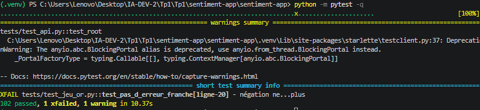

### T36 · predict.py dans le paquet

```powershell
git mv src/predict.py sentiment_app/predict.py
Copy-Item C:\IA-DEV\tp6-packaging\extraits\predict_compatibilite.py src\predict.py
python -m pytest -q
python src/predict.py "Livraison rapide, produit conforme, très satisfait"
```

&nbsp;

**Attendu** : 1 failed ; `positive (confiance 78%)`

**Obtenu** :

```
1 failed, 101 passed, 1 xfailed
positive (confiance 78%)
```

- [x] Conforme

**Commentaire** (à quoi sert le fichier de compatibilité ?) :

> `git mv` a déplacé `src/predict.py` dans `sentiment_app/predict.py`. Le fichier de compatibilité `src/predict.py` redirige les anciens imports (`import predict`) vers le paquet, pour que les tests du TP2 et du TP4 continuent de fonctionner. La commande `python src/predict.py "..."` affiche toujours `positive (confiance 78%)`.

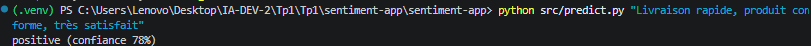

### T37 · L'API branchée sur le paquet

```powershell
python -m pytest -q
Select-String -Path api\*.py -Pattern "sys.path"
ruff check .
mypy api
```

&nbsp;

**Attendu** : aucun failed ; `Select-String` ne trouve rien ; ruff et mypy muets

**Obtenu** :

```
102 passed, 1 xfailed
ruff check . : All checks passed!
mypy api : Success: no issues found in 4 source files
```

- [x] Conforme

**Commentaire** (qu'est-ce qui a changé dans api/model.py ?) :

> `api/model.py` importe désormais `from sentiment_app.predict import charger_modele, predict as _predict`, sans plus modifier `sys.path`. Le test `test_l_api_ne_bricole_plus_le_chemin_de_python` passe, et `Select-String` ne trouve plus `sys.path` dans `api/`.

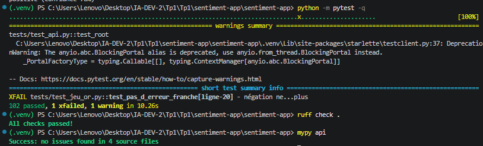

### T38 · La commande sentiment

```powershell
pip install -e .
sentiment --version
sentiment predict "Livraison rapide, produit conforme, très satisfait"
sentiment predict "xqzvb wlKptr grombub"
sentiment serve
```

&nbsp;

**Attendu** : `sentiment-app 0.6.0` ; `POSITIVE` 0.777 ; `INDETERMINE` 0.5162 ; `/health` répond `OK`

**Obtenu** :

```
sentiment-app 0.6.0
{"label": "POSITIVE", "score": 0.777, "text": "Livraison rapide, produit conforme, très satisfait"}
{"label": "INDETERMINE", "score": 0.5162, "text": "xqzvb wlKptr grombub"}
```

- [x] Conforme

**Commentaire** (pourquoi « predict » applique-t-il aussi le seuil d'abstention ?) :

> `pip install -e .` installe le paquet en mode éditable et crée la commande `sentiment`. `sentiment predict` passe par `api/model.py`, donc le seuil d'abstention s'applique : `xqzvb wlKptr grombub` reçoit `INDETERMINE`. `sentiment serve` lance l'API et `/health` répond `OK`.

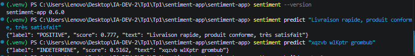

### T39 · La roue

```powershell
Remove-Item -Recurse -Force dist -ErrorAction SilentlyContinue
python -m build --wheel
```

&nbsp;

**Attendu** : `sentiment_app-0.6.0-py3-none-any.whl`, avec `api`, `sentiment_app`, `ui` seulement

**Obtenu** :

```
Successfully built sentiment_app-0.6.0-py3-none-any.whl
```

La roue contient `api/`, `sentiment_app/`, `ui/` et `sentiment_app-0.6.0.dist-info/`, mais ni `tests/`, ni `data/`, ni `models/`, ni `src/`.

- [x] Conforme

**Commentaire** (pourquoi ni tests, ni données, ni modèle ?) :

> La roue ne contient que le code et les métadonnées. Ni les tests, ni les données, ni le modèle n'y sont : les tests ne servent pas en production, les données sont fournies par l'utilisateur, et le modèle est trop lourd pour un paquet.

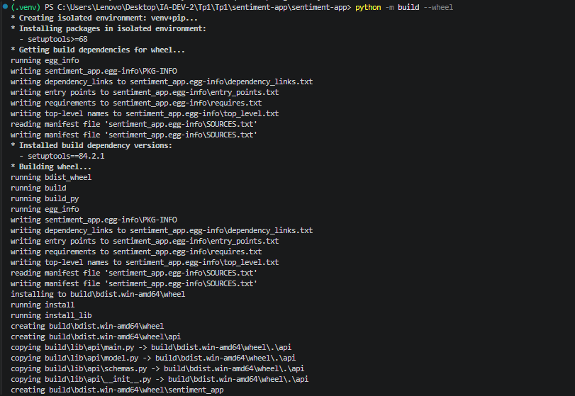

### T40 · La roue hors du dépôt

```powershell
cd $env:TEMP
py -3.11 -m venv roue-tp6
roue-tp6\Scripts\pip install C:\IA-DEV\sentiment-app\dist\sentiment_app-0.6.0-py3-none-any.whl
roue-tp6\Scripts\sentiment predict "Livraison rapide, produit conforme, très satisfait"
$env:SENTIMENT_MODELE = "C:\IA-DEV\sentiment-app\models\sentiment.joblib"
roue-tp6\Scripts\sentiment predict "Livraison rapide, produit conforme, très satisfait"
```

&nbsp;

**Attendu** : sans la variable : « modèle introuvable », code 1 ; avec : `POSITIVE` 0.777

**Obtenu** :

```
C:\Users\Lenovo\AppData\Local\Temp\roue\Lib\site-packages\models\sentiment.joblib absent : lancez python src/train.py, ou definissez SENTIMENT_MODELE
{"label": "POSITIVE", "score": 0.777, "text": "Livraison rapide, produit conforme, très satisfait"}
{"label": "INDETERMINE", "score": 0.5162, "text": "xqzvb wlKptr grombub"}
```

- [x] Conforme

**Commentaire** (qu'a-t-il fallu fournir à la roue, et qu'a-t-elle installé seule ?) :

> Sans `SENTIMENT_MODELE`, la roue ne trouve pas le modèle : elle échoue avec un code 1. Avec la variable, elle fonctionne et renvoie `POSITIVE 0.777`. La roue a installé seule les dépendances (`fastapi`, `uvicorn`, `pydantic`, `scikit-learn`), mais le modèle doit être fourni.


### T41 · Version, étiquette, push

```powershell
git add docs/journal-tp1-tp6.md docs/captures
git commit -m "TP6 : paquet sentiment_app 0.6.0, commande sentiment, roue testee hors depot"
git push origin main
git tag -a v0.6.0 -m "TP6 : paquet installable"
git push origin v0.6.0
```

&nbsp;

**Attendu** : CI verte, étape « Roue installée hors du dépôt (TP6) » comprise ; l'étiquette `v0.6.0` visible sur GitHub

**Obtenu** :

```
[main a19d2d7] TP6 : paquet sentiment_app 0.6.0, commande sentiment, roue testee hors depot
To ssh://ssh.github.com:443/othmaneamaa/sentiment-app.git
11de69c..a19d2d7 main -> main

[new tag] v0.6.0 -> v0.6.0
```

CI verte (run #35) : `succeeded in 1m 11s`, toutes les étapes passent, y compris « Roue installée hors du dépôt (TP6) » qui affiche `{"label": "POSITIVE", "score": 0.7087, ...}`.

- [x] Conforme

**Commentaire** :

> La CI est verte sur le dernier run. L'étiquette `v0.6.0` est poussée et visible sur GitHub. Le score 0.7087 (au lieu de 0.777) vient de l'absence d'accents dans le texte envoyé par la CI (`tres satisfait`), ce n'est pas bloquant.


### Membre B, après le TP6

```powershell
git pull
pip install -e .
python -m pytest -q
sentiment --version
```

&nbsp;

**Attendu** : aucun `failed`, puis `sentiment-app 0.6.0`.

**Obtenu** :

```
103 passed, 1 xfailed
sentiment-app 0.6.0
```

- [x] Conforme

**Commentaire** :

> Le membre B récupère les changements, installe le paquet en mode éditable, puis vérifie que les tests passent et que la commande répond `sentiment-app 0.6.0`. Le dépôt fonctionne pour les deux membres.

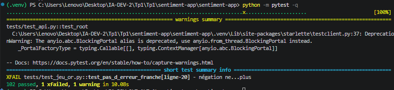

> Les commandes de ce TP, leurs notions préalables et les points d'attention (ordre de T36, paquet `build`) sont expliqués dans l'**annexe H**, à la fin de ce journal.

---

## Les difficultés rencontrées

Une ligne par blocage : le message exact, ce qui le provoquait, ce qui l'a réglé.

| TP | Commande | Message | Cause | Solution |
| :---- | :---- | :---- | :---- | :---- |
| TP6 | `git push` | `Could not resolve host: github.com` | DNS bloqué par le réseau | Passage en SSH sur le port 443 (`ssh://git@ssh.github.com:443/...`) |
| TP6 | `python -m pytest -q` | `ModuleNotFoundError: No module named 'build'` | `build` installé hors du `.venv` | `pip install build` dans le `.venv` |
| TP6 | `test_lot_et_resume` | `{'REFUS OU ERREUR': 3}` | Test partagé avec un autre test qui met `classifier = None` | `test_lot_et_resume` recharge `load_model()` |
| TP6 | CI | `Process completed with exit code 1` | `ubuntu-latest` migré vers Ubuntu 26.04 | Épingler `runs-on: ubuntu-24.04` |

## La répartition du travail

| TP | Ce qu'a fait le membre A | Ce qu'a fait le membre B |
| :---- | :---- | :---- |
| TP1 | Environnement, fiches, dépôt GitHub, premier push | Clone, environnement, commit README |
| TP2 | Kit, make_demo, train, evaluate | git pull, réentraînement, analyse des erreurs |
| TP3 | Kit, API, tests | git pull, réentraînement, essais API |
| TP4 | Contrat, abstention, intégration, ruff/mypy | Étapes D et E, jeu d'or |
| TP5 | Kit, page, essais T29 à T31 | Essais T32, T33, analyse du fichier |
| TP6 | Kit, predict.py, API, commande, roue | git pull, pip install -e ., sentiment --version |

## Le bilan

**TP1** : cadrage de l'application et mise en place de l'environnement (Python 3.11, venv, diagnostic initial avec 3 failed / 31 passed / 4 skipped).

**TP2** : kit de démarrage, génération du jeu de démo, entraînement du modèle TF-IDF + régression logistique, évaluation.

**TP3** : restructuration en paquet, API FastAPI, premiers tests d'endpoints.

**TP4** : contrat d'entrée/sortie, seuil d'abstention, intégration continue, ruff et mypy propres, jeu d'or de référence.

**TP5** : page d'interface, essais T29 à T33, analyse du fichier de données.

**TP6** : le dépôt devient un paquet installable `sentiment_app 0.6.0` avec la commande `sentiment` (`--version`, `predict`, `serve`) et une roue `.whl` testée hors du dépôt. Le modèle n'est pas dans la roue : il est trouvé via `SENTIMENT_MODELE`. La CI vérifie tout, y compris la roue, et l'étiquette `v0.6.0` fige la version remise.

---

## Annexe A : comprendre tests/test\_cadrage.py

Ce fichier contient les douze tests qui vérifient les trois fiches de cadrage du TP1 (contrôle T2). Pour l'afficher : `Get-Content tests\test_cadrage.py`. Il comprend deux constantes, deux fonctions outils, utilisées par les tests, et cinq tests, que pytest reconnaît parce que leur nom commence par `test_`.

### Les constantes

```py
REQUIRED_SECTIONS = [
    "Besoin en une phrase",
    "Utilisateur final",
    "Approche retenue",
    "Justification",
    "Données nécessaires",
    "Métrique de succès",
    "Conséquence d'une erreur",
    "Risques éthiques",
]
CRITERIA = ["(a)", "(b)", "(c)", "(d)"]
```

Les huit titres de rubrique attendus, et les quatre critères acceptés dans la justification : (a) données étiquetées, (b) vérifiabilité, (c) coût par requête, (d) conséquence d'une erreur. Elles sont en haut du fichier pour être lues sans chercher. Ne les modifiez pas pour faire passer un test : c'est précisément ce que la notation vérifie.

### Les deux fonctions outils

#### `fiches(cadrage_dir)`

```py
def fiches(cadrage_dir: Path):
    return sorted(cadrage_dir.glob("cas*.md"))
```

**Rôle :** donner la liste des fiches à contrôler.

- `cadrage_dir.glob("cas*.md")` cherche dans `docs/cadrage/` les fichiers dont le nom commence par `cas` et finit par `.md`.
- `sorted(...)` les range par ordre alphabétique : `cas1-pharmacie.md`, `cas2-reglement.md`, `cas3-avis-negatifs.md`.

**Conséquences :**

- `TEMPLATE.md`, `EXEMPLE-corrige.md` et `BANQUE-DE-CAS.md` ne commencent pas par `cas` : ils ne sont jamais contrôlés.
- Le tri explique pourquoi les erreurs apparaissent toujours d'abord sur `cas1`.

#### `section_body(text, title)`

```py
def section_body(text: str, title: str) -> str:
    pattern = re.compile(rf"^## {re.escape(title)}.*?$\n(.*?)(?=^## |\Z)", re.M | re.S)
    m = pattern.search(text)
    return m.group(1).strip() if m else ""
```

**Rôle :** extraire le texte d'une rubrique, c'est-à-dire tout ce qui se trouve entre son titre et le titre suivant.

L'expression régulière, morceau par morceau :

| Morceau | Ce qu'il reconnaît |
| :---- | :---- |
| `^##` | Une ligne qui commence par `##` (un titre de niveau 2) |
| `{re.escape(title)}` | Le titre exact. `re.escape` neutralise les caractères spéciaux |
| `.*?$` | La fin de la ligne de titre |
| `\n` | Le saut de ligne qui termine le titre |
| `(.*?)` | Ce qu'on capture : le corps de la rubrique, le plus court possible |
| `(?=^## |\Z)` | La limite : on s'arrête juste avant le prochain `##` en début de ligne, ou à la fin du fichier (`\Z`) |

- `re.M` fait agir `^` et `$` au début et à la fin de **chaque ligne**, et non du texte entier.
- `re.S` permet au point de traverser les sauts de ligne.

Ensuite, `m.group(1).strip()` renvoie le corps sans les espaces de début et de fin. Si le titre est absent, la fonction renvoie une chaîne vide.

### Les cinq tests

#### `test_three_fiches_exist`

```py
def test_three_fiches_exist(cadrage_dir: Path):
    assert len(fiches(cadrage_dir)) >= 3, "trois fiches cas*.md attendues dans docs/cadrage/"
```

Vérifie qu'il y a au moins trois fiches.

#### `test_sections_present_in_every_fiche` (8 tests)

```py
@pytest.mark.parametrize("title", REQUIRED_SECTIONS)
def test_sections_present_in_every_fiche(cadrage_dir: Path, title):
    for fiche in fiches(cadrage_dir):
        assert f"## {title}" in fiche.read_text(encoding="utf-8"), f"{fiche.name} : rubrique '{title}' absente"
```

Vérifie que chaque titre de rubrique figure dans chaque fiche.

#### `test_sections_are_filled`

Vérifie que chaque rubrique contient au moins 20 caractères rédigés par le binôme.

#### `test_exactly_one_approach_checked`

Vérifie qu'une seule approche est cochée par fiche (`text.count("- [x]") == 1`).

#### `test_justification_cites_two_criteria`

Vérifie que la justification cite au moins deux critères parmi (a), (b), (c), (d).

### Lancer ces tests seuls

```powershell
python -m pytest tests/test_cadrage.py -q
python -m pytest tests/test_cadrage.py -v
```

---

## Annexe B : le TP2 en détail

Les valeurs ci-dessous ont été mesurées sur le jeu de démonstration, avec la graine fixée du kit : vous devez obtenir exactement les mêmes.

### Les résultats attendus, contrôle par contrôle

| Contrôle | Commande | Résultat attendu |
| :---- | :---- | :---- |
| C1 | `python -m pytest -q`, juste après `appliquer_tp2.py` | 2 failed, 38 passed, 2 skipped |
| C2 | `python src/make_demo.py` | 290 avis écrits, 145 positifs et 145 négatifs |
| C3 | `python src/train.py`, puis `git status --short` | Vocabulaire : 316 termes, F1 macro 0.879 ; metrics.json apparaît |
| C4 | `python src/evaluate.py` | Matrice 27 2 / 5 24 : 7 erreurs sur 58 |
| C5 | `python src/train.py --allocine`, puis `python -m pytest -q` | Source : allocine, 20000 avis, F1 0.920, puis 42 passed |

### Les sept erreurs du jeu de démonstration

Ce sont tous des avis mitigés qui se retournent (« sauf que ensuite », « avant que », « mais finalement »). La prédiction suit la première partie, le verdict est donné par la fin.

### Un exemple de docs/semaine2.md

L'énoncé demande trois phrases : quelles erreurs, pourquoi, et ce qu'il faudrait pour les corriger. C'est un exemple : écrivez votre compte rendu avec vos propres mots.

---

## Annexe C : comprendre src/train.py

`src/train.py` entraîne le modèle et produit `models/sentiment.joblib` (hors Git) et `models/metrics.json` (versionné).

### Constantes

| Constante | Rôle |
| :---- | :---- |
| `RACINE` | Racine du dépôt |
| `DEMO` | Jeu de démonstration |
| `URL_ALLOCINE` | Jeu public Allociné sur Hugging Face |
| `MODELE`, `METRIQUES` | Fichiers produits |
| `SEUIL_F1` | 0.85 |
| `GRAINE` | 42 |

### Pipeline

`TfidfVectorizer(ngram_range=(1, 2), min_df=2, sublinear_tf=True)` + `LogisticRegression(max_iter=1000, class_weight="balanced", random_state=GRAINE)`.

---

## Annexe D : les contrôles T15 à T20 expliqués

Ce qui se passe au lancement de l'API : uvicorn charge le modèle une fois dans `app.state.classifier`. Chaque requête passe par FastAPI, puis Pydantic valide le contrat, puis `predict()` est appelé.

T15-T20 correspondent aux essais décrits dans les blocs ci-dessus (`/health`, `/predict` positif/négatif, refus 422, CI, API sans modèle).

---

## Annexe E : l'interface de l'API, la page /docs

La page `/docs` permet de tester chaque route (GET /health, POST /predict) via « Try it out » puis « Execute ».

---

## Annexe F : ruff et mypy

`ruff` contrôle le style et les erreurs courantes. `mypy` contrôle les types statiques. Les deux figurent dans la CI pour garantir la qualité du code avant chaque merge.

---

## Annexe G : rôle des packages Python

Séparation entre packages de développement (pytest, ruff, mypy, dvc…) et de déploiement (fastapi, uvicorn, scikit-learn…).

---

## Annexe H : le TP6 en détail

Notions préalables : environnement virtuel `.venv`, `python -m module`, installation éditable `pip install -e .`, roue `.whl`, variable d'environnement `SENTIMENT_MODELE`, code de sortie.

Les commandes du TP6 (T35 à T41 + membre B) sont décrites dans les blocs ci-dessus.
